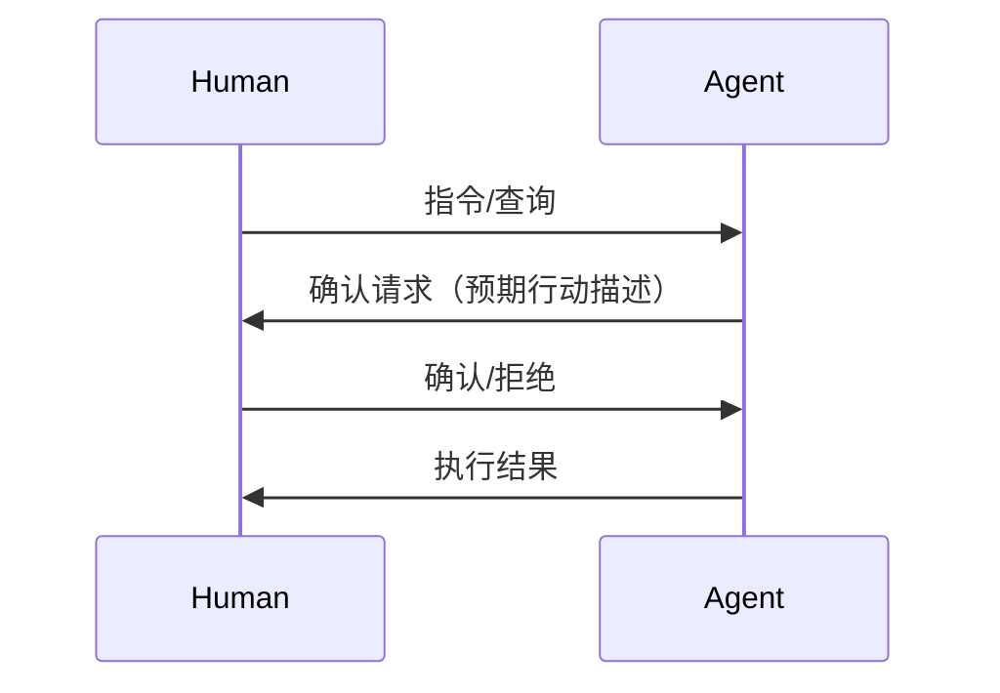

# 人机交互设计 —— 领域约定

**领域:** 人机交互设计
**类型:** 🔷 进阶
**目录:** `topics/human-agent-interaction/`
**入口文件:** `index.md`

## 领域范围

本话题关注 Agent 与人类之间的交互模式、反馈循环设计、信任构建机制以及 Human-in-the-Loop 架构。

## 文档分类

| 类别 | 命名模式 | 示例 |
|------|----------|------|
| 交互模式 | interaction-pattern-*.md | interaction-pattern-command.md |
| 反馈机制 | feedback-*.md | feedback-confirmation-loop.md |
| 信任设计 | trust-*.md | trust-transparency-principles.md |
| HITL 架构 | hitl-*.md | hitl-approval-gate.md |
| 界面原则 | ux-*.md | ux-agent-interface.md |

## 内容规范

### 交互流程图约定

交互流程以 Mermaid 时序图表示：



- `Human` 参与者始终在左侧，`Agent` 在右侧
- 交互步骤按时间顺序从上到下排列
- 关键决策点用 `alt/else` 块标注分支

### 反馈消息格式

反馈记录以结构化的方式标注：

```
[反馈类型] 触发点 -> 预期行为 -> 实际行为 -> 用户响应
```

| 字段 | 说明 |
|------|------|
| 反馈类型 | 确认 / 纠错 / 拒绝 / 补充 |
| 触发点 | 触发该反馈的 Agent 行动 |
| 预期行为 | Agent 假设的用户意图 |
| 实际行为 | 用户的真实意图表达 |
| 用户响应 | 用户给出的具体反馈内容 |

### HITL 决策点标注

在架构描述中，HITL 决策点使用 `[HITL]` 标记，后跟决策粒度和超时策略。

## 相关话题

- `../safety-and-alignment/` — 安全交互与对齐
- `../agent-architecture/` — HITL 架构集成
- `../../patterns/` — 人机交互设计模式

---

> *本文档为领域约定，用于统一话题下的文档编写规范。*