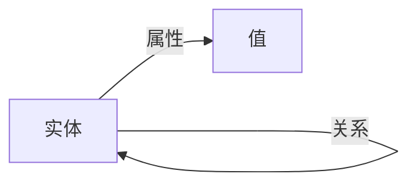

# 知识表示与管理 —— 领域约定

**领域:** 知识表示与管理
**类型:** 🔷 进阶
**目录:** `topics/knowledge-representation/`
**入口文件:** `index.md`

## 领域范围

本话题关注 Agent 如何表示、存储和检索知识，覆盖知识图谱、向量存储、结构化与非结构化知识的融合策略。

## 文档分类

| 类别 | 命名模式 | 示例 |
|------|----------|------|
| 知识格式 | knowledge-format-*.md | knowledge-format-rdf.md |
| 检索方法 | retrieval-*.md | retrieval-hybrid-search.md |
| 存储引擎 | storage-*.md | storage-vector-db.md |
| 更新策略 | update-*.md | update-conflict-resolution.md |
| 融合方案 | fusion-*.md | fusion-structured-unstructured.md |

## 内容规范

### 知识图谱 Schema 约定

图谱 schema 以 Mermaid 流程图表示：



- 节点表示实体类型，标注类型名（如 `Agent`、`Tool`）
- 边表示关系，标注关系名（如 `uses`、`depends_on`）
- 属性值标注在节点下方

### 向量检索格式

检索结果以结构化 JSON 呈现：

```json
{
  "query": "用户查询文本",
  "top_k": 5,
  "results": [
    {
      "id": "chunk_001",
      "score": 0.92,
      "source": "documents/architecture.md",
      "metadata": { "topic": "agent-architecture" }
    }
  ]
}
```

### 混合检索评估

每种混合策略必须附带检索质量指标（Recall@K、MRR、NDCG）。

## 相关话题

- `../memory-and-state/` — 记忆系统与知识持久化
- `../tool-use/` — 知识库工具调用模式
- `../agent-architecture/` — RAG 架构设计

---

> *本文档为领域约定，用于统一话题下的文档编写规范。*