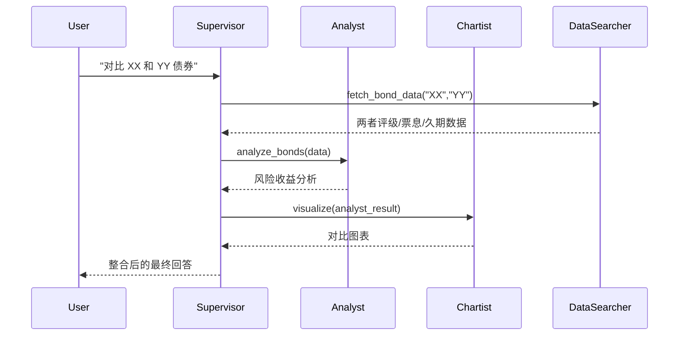
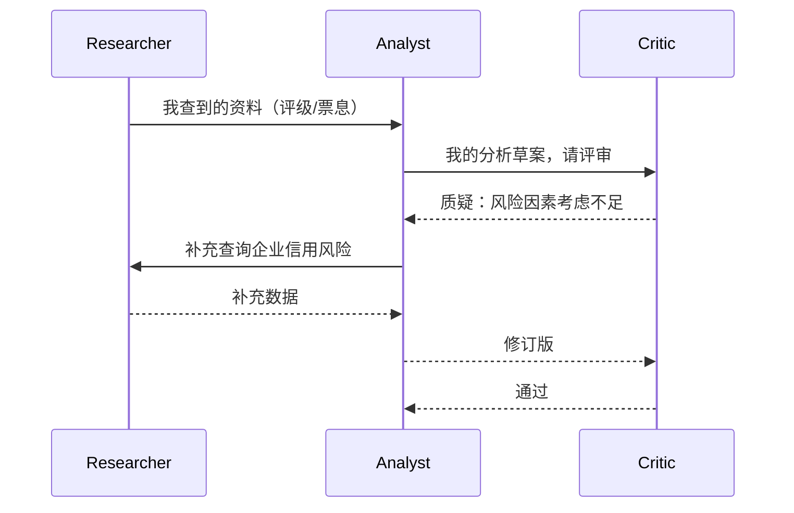
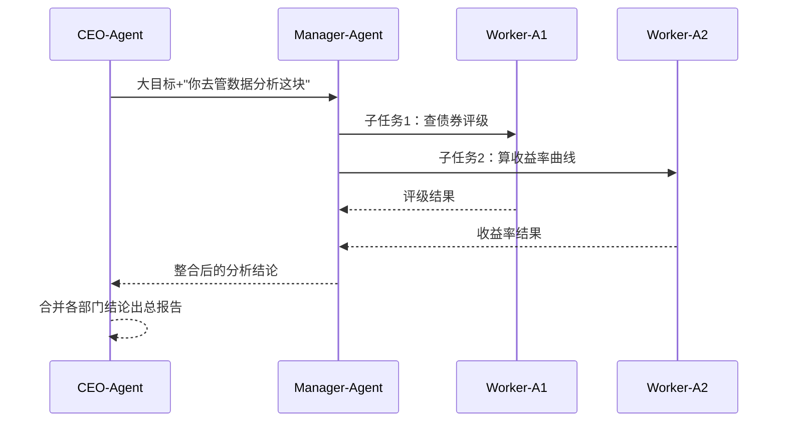

# 多 Agent 协作模式：Supervisor / Peer / Hierarchical 全对比

> **这是什么:** 多个 AI Agent 怎么分工协作——**Supervisor**（老板-员工）、**Peer**（对等协作）、**Hierarchical**（分层管理）三种架构模式的对比与选型。面试题 #16 的答案素材。
> **为什么重要:** 单 Agent 有认知天花板（一个模型一个角色、一个上下文窗口），多 Agent 把任务拆给"不同专家"并行做——但"怎么组织一群 Agent"是架构决策，选错模式协作就崩。
> **本文定位:** 理论为主，但**每个模式都结合 BondSeek 生产实例**看落地——你会看到"模式不是背概念，而是解决真实协作问题的套路"。
> **关联案例:** [多 Agent 编排](../../patterns/case-study-bondseek-multi-agent.md) | [认知架构范式](../agent-architecture/cognitive-architecture-paradigms.md) | [函数调用原理](../tool-use/function-calling.md)（SubAgent 工具化的前提）| [可观测性](../../patterns/case-study-bondseek-observability.md)（调用树）

## 📌 名词速查表（先看这里）

| 英文 | 读作/理解成 | 一句话解释 |
|------|------------|-----------|
| **Supervisor** | "监工/老板（专有名词）" | 中心 Agent 负责把任务分给专家 Agent，收集结果 |
| **Peer** | "对等方（专有名词）" | Agent 之间平级直接对话协作，没有中心 |
| **Hierarchical** | "分层（专有名词）" | 多层管理：顶层老板管中层老板，中层管执行者 |
| **Orchestration** | "编排（专有名词）" | 中心化协调——一个大脑指挥其他人 |
| **Decentralized** | "去中心化" | 没有统一大脑，Agent 自主协商 |
| **Sub-Agent** | "子代理（专有名词）" | 被大 Agent 委派执行子任务的 Agent |
| **Delegation** | "委派" | 把子任务交给另一个 Agent 做 |
| **Handoff** | "交接（专有名词）" | 把当前对话/任务转交给另一个 Agent |
| **Tool 化包装** | "包装成工具" | 把子 Agent 伪装成工具，让主 Agent 像调工具一样调它 |
| **黑盒沟通** | "只传结果" | 子 Agent 之间不共享中间过程，只传摘要/结论 |

---

## 🎯 TL;DR 冲突摘要（先看这段）

> **这篇文档解决的核心矛盾：一个 Agent 干不了复杂任务——单个模型只有一个角色（会分析债券的通常不精通画图）、一个上下文窗口（塞不下所有专家知识）、一串思考（无法并行）。** 多 Agent 的解法是"把任务拆开、分给不同专家、再拼回来"。但**"怎么组织这群专家"走到岔路口**：**是设一个老板（Supervisor）统一指挥，还是让专家平级自己协商（Peer），还是建多层管理（Hierarchical）？**
> 三种模式不是选择题而是**代价交换**：**Supervisor** 最可控（有大脑）但中心会成瓶颈（老板忙死、专家闲死、老板挂了全瘫）；**Peer** 最灵活（无中心）但最不可控（没有全局视图、容易互相打转）；**Hierarchical** 能管超大团队（分层治理）但最重（多层通信延迟、层间信息失真）。
> 生产系统的答案永远是**混合**——BondSeek 就是"**Supervisor 做顶层编拍板 + Sub-Agent 工具化包装做执行**"：**老板 Agent 和专家 Agent 唯一的沟通通道是"工具调用"**——主 Agent 把"调用 technical_analyst"当成调一个工具，专家完全黑盒地干活，只回一个摘要。读完全文你需要带走一个判断标准：**选模式前先问"这个任务的控制权该给谁"——要确定性选 Supervisor、要灵活性选 Peer、团队大到单层管不住选 Hierarchical、生产落地多半是"一个能调工具的 Supervisor + 一群黑盒专家"。**

---

## 1. 为什么需要多 Agent（先理解问题）

单 Agent 的天花板：

| 单 Agent 的局限 | 例子 |
|----------------|------|
| **单角色** | 一个 Agent 要么是"债券分析师"要么是"图表专家"，难以一人分饰多角 |
| **单上下文窗口** | 所有专家知识塞一个窗口 → 容量 + 噪声双重爆炸 |
| **顺序执行** | 一个 Agent 只能一条思考链走到底，无法并行查数据 |
| **单点责任** | 又做检索又做总结又做校验——一个环节弱全盘弱 |

**多 Agent 的核心收益**：**角色隔离 + 上下文隔离 + 并行 + 专家化**——每个 Agent 是"小且专的专家"，各干各的擅长活，通过协作拼出大结果。

---

## 2. 三大模式全景对比（先看这张表）

| 维度 | **Supervisor（老板）** | **Peer（对等）** | **Hierarchical（分层）** |
|------|----------------------|-----------------|------------------------|
| 控制中心 | ✅ 有（一个大脑） | ❌ 无（平级协商） | ✅ 有（多层大脑） |
| 决策方式 | 老板集中决策+委派 | 每个 Agent 自主权衡 | 顶层定方向，中层拆任务，底层执行 |
| 通信拓扑 | 星型（老板↔专家） | 网状（任意互聊） | 树型（层间单向流转） |
| 最大优点 | **可控、有全局视图** | **灵活、无单点故障** | **可扩到超大团队、层级治理** |
| 最大缺点 | 老板是瓶颈+单点故障 | 无全局视图、易失控 | 通信延迟、层间信息失真 |
| 结构性比喻 | 球队教练指挥球员 | 同事围桌讨论 | 公司组织架构（CEO→经理→员工） |
| 典型框架 | LangGraph Supervisor / CrewAI | AutoGen GroupChat / OpenAI Swarm | LangGraph Hierarchical / MetaGPT |
| 适合场景 | 任务可分、需统一质量把控 | 创意/讨论型、平等角色 | 巨型任务、企业级复杂流程 |

**一句话记忆**：
- **Supervisor = 一个大脑指挥众手**（有中心）
- **Peer = 众脑平级自由讨论**（无中心）
- **Hierarchical = 多级大脑层层下放**（有分层中心）

---

## 3. Supervisor 模式：老板指挥专家 ⭐（最常用）

### 3.1 交互流程



### 3.2 Supervisor 的职责

| 职责 | 说明 |
|------|------|
| **拆任务** | 把用户大问题拆成子任务 |
| **选专家** | 判断"这个问题该派给哪个专家"（决策权集中在这） |
| **传参数 / 收结果** | 把必要上下文传给专家，收专家摘要 |
| **整合输出** | 把多个专家结果拼成最终答案 |
| **质量把控** | 结果不好 → 派回去重做或换专家 |

### 3.3 优点 / 缺点 / 缓解

| 优点 | 缺点 | 缓解手段 |
|------|------|---------|
| 有全局视图，任务可预期 | **老板是瓶颈**（所有决策压一个 Agent） | 老板只做拆分不做执行，重心轻 |
| 质量可控（老板把关） | **单点故障**（老板挂了全瘫） | 老板改多副本/重试兜底 |
| 团队增员简单（加专家即可） | 专家能力闲置（老板不派就闲着） | 任务较多时并行派多个专家 |

> **面试金句**：Supervisor 的本质是**"把决策权集中在顶层"**——主 Agent 是"拆任务 + 选专家 + 整合"的大脑，子 Agent 是"只会干一件事的专家"。**代价是老板必须聪明且稳定，因为它是唯一的决策点。**

### 3.4 BondSeek 落地：Supervisor + Sub-Agent 工具化 ⭐⭐⭐

BondSeek 的编排（orchestrator）就是 Supervisor 模式的实战样板，最值得学习的设计是**"把子 Agent 包装成工具"**：

```
主 Agent（orchestrator）= Supervisor："你这个大问题，我决定派哪个专家"
    │
    ├─ 工具: technical_analyst（专家被包装成"工具"）
    │      └─ 内部：完整子会话（自己的上下文/工具/轮数上限）→ 只回摘要
    ├─ 工具: data_analyst
    ├─ 工具: visualization_expert
    └─ 工具: dashboard_creator
```

**三个关键设计**：

| 设计 | 解决什么 |
|------|---------|
| **专家 = 工具（Tool 化包装）** | 主 Agent 复用"工具调用"机制——它不需要知道"如何派给 Agent"，只说"调用 technical_analyst"（呼应 #15 函数调用原理：Sub-Agent 就是特殊工具） |
| **每次全新子会话** | 专家 Agent 是"无状态"的——每次委派都开全新会话，不背历史包袱（防上下文污染） |
| **只回摘要** | 专家和主 Agent 之间**黑盒沟通**——只有"我干了什么 + 结论是什么"，中间细节不进主 Agent 上下文 |

> **为什么"工具化包装"是神来之笔**：它把"多 Agent 编排"降维成"工具调用"——**主 Agent 不需要新的编排机制，用的是已有的工具循环**；专家之间的交互被收窄成"各干各的、只传结果"，彻底避免"一群 Agent 互相聊晕"的 Peer 式失控。

> 📎 深挖：[`case-study-bondseek-multi-agent.md`](../../patterns/case-study-bondseek-multi-agent.md) §SubAgent 工具化包装 + §统一 ExecutionEngine

---

## 4. Peer 模式：对等协作

### 4.1 交互流程



### 4.2 核心特征：没有中心，全靠协商

- Agent 之间**直接对话**（无中间人）
- 每个 Agent 自主决定"该不该说话、跟谁说、说什么"
- **结果靠共识/投票收敛**，没有谁说了算

### 4.3 优点 / 缺点 / 适用

| 优点 | 缺点 | 适用场景 |
|------|------|---------|
| 无单点故障（无中心可挂） | **无全局视图**（谁也不知道全局） | **头脑风暴**（多角色自由碰撞） |
| 灵活（角色可动态增减） | **易失控**（可能互相打转不收敛） | **评审-修订循环**（找答案改进） |
| 平等，无层级浪费 | 通信复杂度高（N 个 Agent 网状互通） | **辩论/共识类**（多观点博弈） |

> **面试金句**：Peer 是把"决策权分散到每个 Agent"——每个人自主判断、互相协商。它灵活，但**没有全局视图 + 谁来收敛是难题**——所以 Peer 模式常配合"共识机制"（投票/批判收敛）避免打转。

### 4.4 框架对应

- **AutoGen GroupChat**：多个 Agent 在一个群聊里自由发言，有"manager"做简单调度
- **OpenAI Swarm**：Agent 之间可互相 `handoff`（交接任务）——一个 Agent 判断"这事该你管"，就把对话让渡过去（本质是"去中心化的委派"）

---

## 5. Hierarchical 模式：分层管理（超大团队的解法）

### 5.1 交互流程



### 5.2 什么时候需要分层

| 单个 Supervisor 不够的信号 | 分层怎么解决 |
|---------------------------|------------|
| 子任务太多，一个老板塞不下 | 每个中层老板只管自己的条线 |
| 子任务太深，需要多级拆解 | 顶层定方向 → 中层拆任务 → 底层干细活 |
| 团队规模大到单层通信爆炸 | 层层收敛，信息按层汇聚 |

### 5.3 优点 / 缺点

| 优点 | 缺点 |
|------|------|
| 可扩展到超大团队（层级治理） | **通信延迟**（每层都是往返开销） |
| 每层职责清晰（方向-拆解-执行） | **信息失真**（层层传递，细节逐层丢失） |
| 局部故障可隔离（下层挂了上层换人） | 实现复杂（多层状态管理） |

> **面试金句**：Hierarchical 是把 Supervisor 递归使用——**老板也有老板**。它适合"任务大到单层管不住"的场景，但**每加一层就多一层延迟和失真**，所以能用单层 Supervisor 就别急着分层。

---

## 6. 怎么选：决策框架 ⭐

| 判断问题 | 答案倾向 |
|---------|---------|
| 任务可以拆成明确的子任务吗？ | 可拆 → Supervisor |
| 需要统一的质量把控吗？ | 需要 → Supervisor |
| 是创意/讨论型任务，观点碰撞有价值吗？ | 是 → Peer |
| 参与者需要完全平等、无中心吗？ | 是 → Peer |
| 任务规模大到单层 Supervisor 管不住？ | 是 → Hierarchical |
| 生产系统求稳、求可控？ | **Supervisor（+工具化包装）** |

**生产系统的通用答案**：**Supervisor 为主 + 工具化包装做执行 + 必要时局部 Peer（评审环节）**——BondSeek 就是这么干的。

---

## 7. 面试回答框架（30 秒版）

### 送分版（只说模式定义）

> "多 Agent 协作主要有三种模式。**Supervisor** 是中心化编排——一个主 Agent 负责任务拆分、选择专家、整合结果，子 Agent 各干一种专长；**Peer** 是去中心化——Agent 之间平级直接协商、互相评审，没有中心控制；**Hierarchical** 是分层——顶层 Agent 管中层、中层管执行者，适合超大任务。选型看任务：可控优先选 Supervisor，灵活讨论选 Peer，团队太大选 Hierarchical。"

### 加分版（+ 生产落地 + 工具化 + 结合项目）⭐

> "我这里特别想说生产落地。我们 BondSeek 用的是 **Supervisor + Sub-Agent 工具化包装**：主 Agent（orchestrator）是唯一的决策点，它负责拆任务、选专家、整合输出；每个专家（technical_analyst / data_analyst / visualization_expert）被**包装成工具**——主 Agent 用'工具调用'的方式'调用专家'，专家在独立的子会话里干活（自己的上下文、工具、轮数上限），**只回一个摘要，中间细节完全黑盒**。这么做有三个好处：主 Agent 不需要新的编排机制（复用工具调用）、专家上下文互相隔离（不污染）、团队加专家只要注册一个新工具（可扩展）。Peer 模式适合头脑风暴但容易失控，我们只在'评审'环节用类似思想。**选模式的核心是回答'决策权给谁'——生产求稳就给 Supervisor。**"

---

## 反模式（本主题避免）

- **子 Agent 共享上下文**——各自开子会话，专家间不互传中间过程（黑盒）
- **让所有 Agent 自由互聊**（Peer 滥用）——消息爆炸 + 不收敛，生产慎用
- **Supervisor 自己也干活**——老板做决策，专家做执行，老板累了决策质量就崩
- **子 Agent 直接白盒沟通依赖**——专家之间不该知道彼此内部，只认摘要
- **层级套太深**——每层延迟+失真翻倍，能用单层别分层

---

## 📖 名词标注表（完整中英对照）

| 英文 | 中文理解 | 详细解释 |
|------|---------|---------|
| **Supervisor** | 监工/老板 | 中心 Agent：拆任务、选专家、整合结果 |
| **Peer** | 对等方 | 平级 Agent 直接协商，无中心 |
| **Hierarchical** | 分层 | 多层管理：顶层→中层→执行层 |
| **Orchestration** | 编排 | 中心化协调所有 Agent 的工作 |
| **Decentralized** | 去中心化 | 无统一大脑，Agent 自主协作 |
| **Sub-Agent** | 子代理 | 被委派执行子任务的 Agent |
| **Delegation** | 委派 | 把子任务交给其他 Agent |
| **Handoff** | 交接 | 把当前对话/上下文让渡给另一个 Agent |
| **Tool 化包装** | 工具化封装 | 把子 Agent 伪装成工具（主 Agent 用工具循环调用） |
| **黑盒沟通** | 只传结果 | 专家之间只传摘要/结论，不共享中间过程 |
| **全局视图** | 全局视角 | 对整个任务的理解（Supervisor 有，Peer 无） |
| **共识机制** | 收敛机制 | Peer 模式避免打转的方式（投票/批判） |
| **单点故障** | 单一故障点 | 中心 Agent 挂了导致整个系统瘫 |

---

## 关联文档

- [`case-study-bondseek-multi-agent.md`](../../patterns/case-study-bondseek-multi-agent.md) — Supervisor + 工具化包装 + 统一 ExecutionEngine 的生产实例
- [`cognitive-architecture-paradigms.md`](../agent-architecture/cognitive-architecture-paradigms.md) — 范式与多 Agent 的关系（编排层的 Plan 思想）
- [`function-calling.md`](../tool-use/function-calling.md) — Sub-Agent 工具化实现的机制基础（工具调用接口）
- [`case-study-bondseek-observability.md`](../../patterns/case-study-bondseek-observability.md) — 工具调用树（多 Agent 协作留痕可视化）
- [`notes/agent-interview-questions.md`](../../notes/agent-interview-questions.md) — 面试话题索引（第 16 题）
